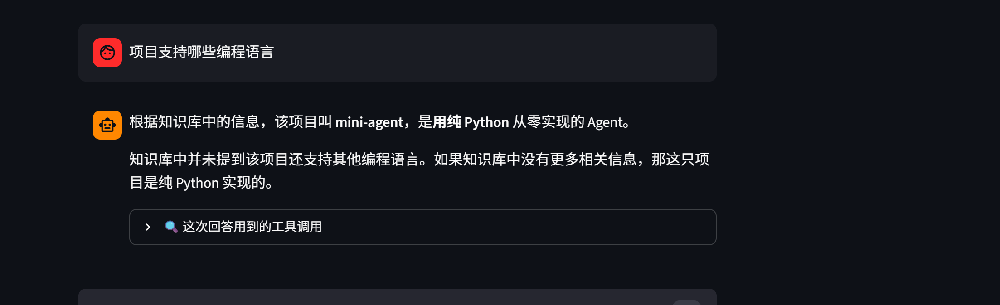

# mini-agent 知识库助手

[](https://mini-agent-kc2exmjbmhtgcdjdjd2zksh.streamlit.app/)

一个**从零手写**的轻量级 Agent 应用：基于 ReAct 循环实现工具调用与多步推理，结合 RAG 检索增强生成，不依赖 LangChain、LlamaIndex 等重框架。

> 在线体验：https://mini-agent-kc2exmjbmhtgcdjdjd2zksh.streamlit.app/

---

## 核心能力

| 能力 | 说明 |
|------|------|
| **ReAct 循环** | 模型自主决定“思考 → 行动 → 观察 → 再思考”，直到得出答案 |
| **工具调用** | 内置 `calculate`、`get_current_time`、`search_docs` 工具，通过 JSON Schema 注册 |
| **RAG 检索** | 读取 `docs/*.md` 自动切块，智谱 `embedding-3` 向量化，手写余弦相似度 top-k |
| **增量向量缓存** | 以内容哈希为键，改一篇文档只重算那篇的块，其余命中本地缓存（0 次接口调用） |
| **相关性阈值** | top1 相似度低于 0.35 直接判定“没查到”，从源头掐掉硬凑答案 |
| **事件回调** | Agent 内部零 `print`，通过 `on_event` 把步数/工具调用抛给命令行或界面 |
| **上下文压缩** | 只保留最近 N 轮原文，更早的按整轮丢弃并压成 ≤120 字摘要，token 不随轮次膨胀 |
| **防幻觉约束** | system prompt + 检索结果带来源 + 阈值三道防线，资料不足时主动说明 |
| **Streamlit 部署** | 已部署至 Streamlit Cloud，支持本地 `.env` 与云端 `st.secrets` 双模式 |

---

## 技术栈

- Python 3.13
- [OpenAI Python SDK](https://github.com/openai/openai-python)（兼容 DeepSeek / 智谱 OpenAI 接口）
- DeepSeek Chat（`deepseek-chat`）
- 智谱 Embedding（`embedding-3`）
- NumPy（向量相似度计算）
- Streamlit（Web 界面与部署）
- python-dotenv（本地环境变量）

---

## 项目结构

```
mini-agent/
├── app.py              # Streamlit 主程序（只负责界面，Agent 逻辑不在这里）
├── agent.py            # Agent 类：ReAct 循环 + 多轮记忆 + 事件回调 + 工具轨迹
├── tools.py            # 工具注册表：函数本体 + JSON Schema，单一来源
├── knowledge.py        # 知识库：加载 docs/ → 切块 → 增量向量化 → 检索
├── docs/               # 知识库原文（markdown，改完重启即生效）
├── .cache/             # 向量缓存（kb_vectors.npz，已 gitignore）
├── agent_loop.py       # 函数式 ReAct 循环（阶段2 教学版，保留对照）
├── agent_class.py      # Agent 类的用法演示（多轮记忆 + 事件打印）
├── tool_call.py        # 单次工具调用教学示例
├── rag_demo.py         # RAG 流程教学示例
├── hello_agent.py      # 首次调通 LLM 的最小示例
├── requirements.txt    # 依赖清单
├── assets/             # 截图等静态资源
└── .gitignore          # 忽略 .venv / .env / __pycache__ / .cache
```

### 分层设计

| 层 | 文件 | 职责 |
|----|------|------|
| 界面层 | `app.py` | 只做渲染与交互，Agent 实例挂在 `st.session_state` 上跨请求存活 |
| 编排层 | `agent.py` | 一次 `chat()` = 一轮对话；`messages` 喂模型、`turns` 给人看 |
| 能力层 | `tools.py` | 工具函数 + Schema，一处定义多处复用 |
| 检索层 | `knowledge.py` | 文档切块、增量向量缓存、余弦相似度 top-k |

> 关键设计：**模型上下文（`messages`）与展示历史（`turns`）分离** —— 前者含 system / tool 等内部消息，后者只保留一问一答及该轮工具轨迹，界面永远不需要理解 OpenAI 的消息协议细节。

---

## 上下文管理

对话不会无限增长，`Agent` 默认只保留最近 6 轮原文：

| 参数 | 默认 | 说明 |
|------|------|------|
| `max_turns` | `6` | 保留最近几轮原文；设 `None` 关闭限制 |
| `summarize_dropped` | `True` | 丢弃前先压成 ≤120 字摘要，挂在 system 之后当背景 |

两个必须说清楚的实现细节：

1. **按“整轮”丢弃，不按“条”** —— 一条 user 消息后面跟着 `assistant(tool_calls)` 和若干 `tool` 消息，靠 `tool_call_id` 配对。拆散它们接口直接 400。
2. **`messages` 里不存 system** —— 由 `_context()` 在请求前临时拼成 `system → 摘要 → 最近原文`，否则裁剪时会把 system 也算进轮次逻辑里。

界面侧边栏可以拖动「记忆轮数上限」实时观察：聊过上限后会出现「已压缩的早期对话摘要」，此时上下文条数不再增长，但被压掉的个人信息依然答得出来。

---

## 维护知识库

往 `docs/` 里丢 `.md` 文件就行，重启应用自动生效：

```markdown
# 文档标题

## 小节标题

正文段落……
```

切块规则：按 `##` 小节切分，段落累加到约 420 字，块首拼上所在小节标题（避免单句脱离语境）。改完重启，日志里会打印 `N/M 个块需要向量化` —— 只重算改动的部分，其余命中缓存。

想强制全量重建（比如换了向量模型）：

```python
from knowledge import build_index
build_index(force=True)
```


---

## 本地运行

### 1. 克隆仓库

```bash
git clone https://github.com/keqi-could/mini-agent.git
cd mini-agent
```

### 2. 创建虚拟环境并安装依赖

```bash
python -m venv .venv
source .venv/bin/activate  # Windows Git Bash: source .venv/Scripts/activate
pip install -i https://pypi.tuna.tsinghua.edu.cn/simple -r requirements.txt
```

### 3. 配置 API Key

在项目根目录创建 `.env` 文件：

```env
DEEPSEEK_API_KEY=你的_DeepSeek_Key
ZHIPU_API_KEY=你的_智谱_Key
```

### 4. 启动 Streamlit

```bash
streamlit run app.py
```

---

## 部署到 Streamlit Cloud

1.  Fork / 使用本仓库，确保代码在 GitHub 上。
2.  访问 [share.streamlit.io](https://share.streamlit.io)，用 GitHub 登录。
3.  新建 App：`keqi-could/mini-agent` → `main` 分支 → `app.py`。
4.  在 App settings → Secrets 中填入：

    ```toml
    DEEPSEEK_API_KEY = "你的_DeepSeek_Key"
    ZHIPU_API_KEY = "你的_智谱_Key"
    ```

5.  点击 Save，等待自动部署完成。

---

## 效果演示

### 正常问答：基于知识库回答“什么是 ReAct？”

模型会自动调用 `search_docs` 工具检索知识库，再基于检索结果生成答案。

### 边界测试：主动拒绝回答未提及的内容



当问及“项目支持哪些编程语言”时，知识库中未明确说明其他语言，模型不会编造，而是基于已有信息说明“这是纯 Python 实现的 Agent”。

---

## 学习路线

本项目适合作为 Agent / RAG 入门简历项目，按以下阶段递进：

1. **阶段 0**：环境准备、API Key 管理、第一个 LLM 调用
2. **阶段 1**：手写工具调用（Function Calling）
3. **阶段 2**：实现 ReAct Agent 循环
4. **阶段 3**：RAG 知识库助手（Embedding + 向量检索）
5. **阶段 4**：Streamlit 界面与线上部署
6. **阶段 5**：README 与简历话术打磨

---

## 作者

- GitHub：[@keqi-could](https://github.com/keqi-could)
- 在线 Demo：https://mini-agent-kc2exmjbmhtgcdjdjd2zksh.streamlit.app/
